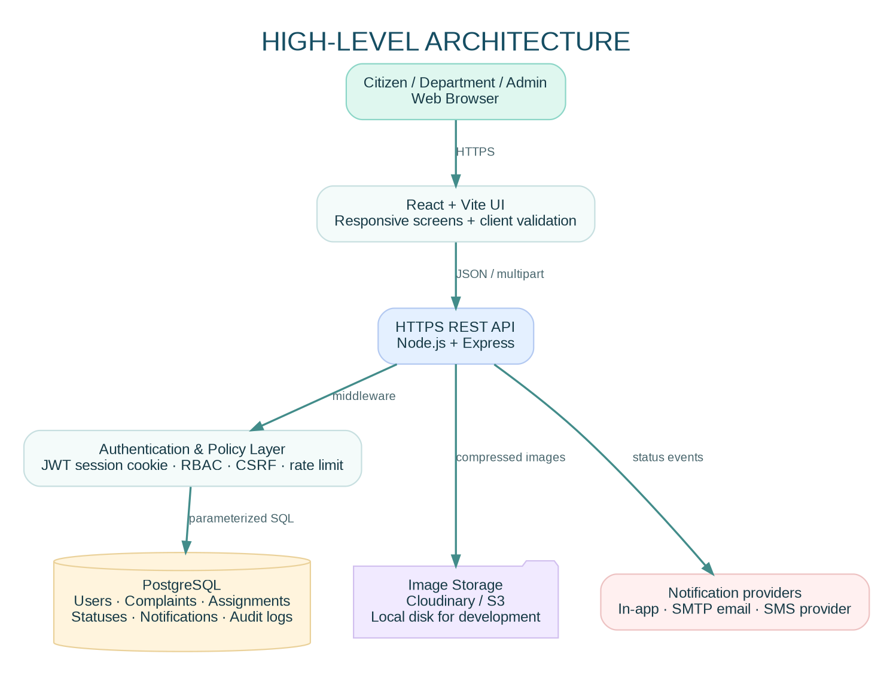
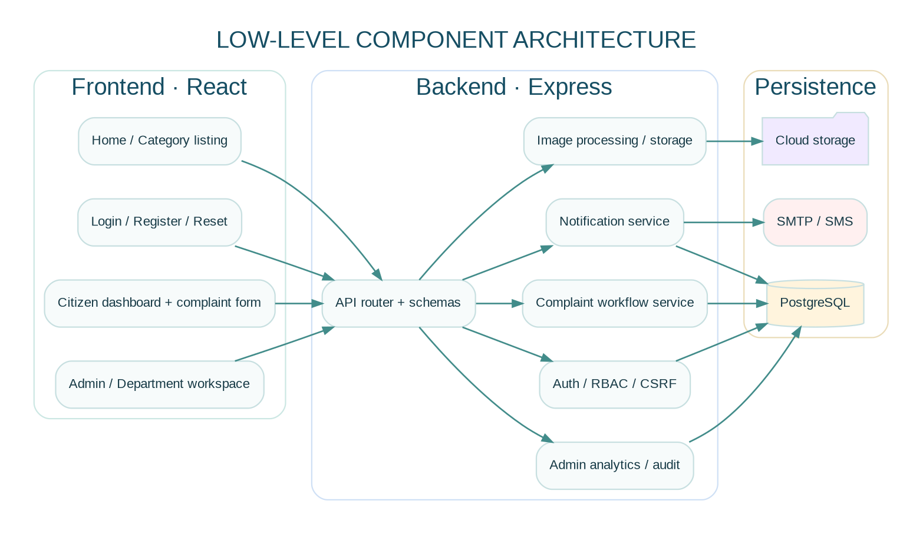
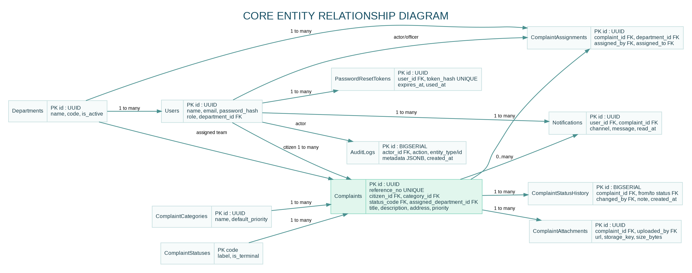
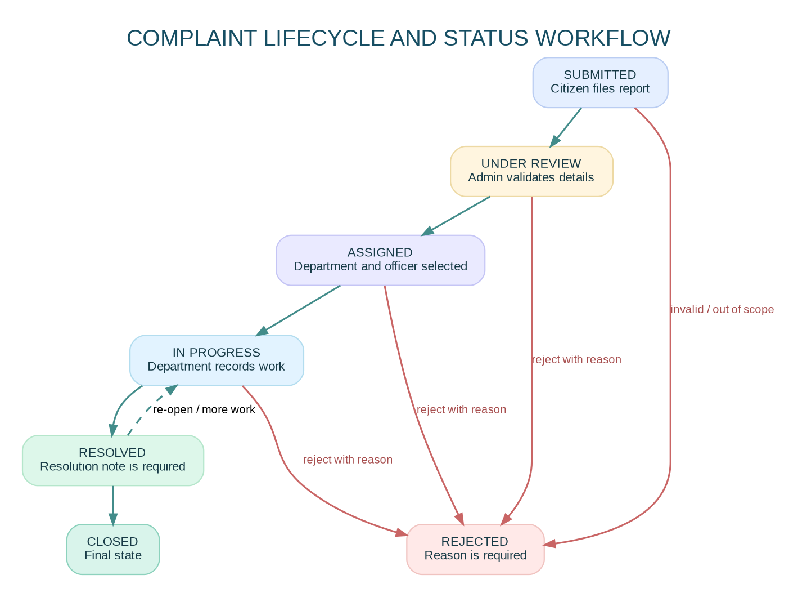

# Software Requirements Specification (SRS)

## Citizen Grievance Reporting and Resolution Portal

**Document version:** 1.0  
**Prepared:** 27 October 2026  
**Document type:** Academic major-project SRS and engineering implementation guide  
**Reference implementation:** CivicConnect  
**Status:** Functional starter implementation with deployment guidance; production use requires security review, operational controls, and approval by the responsible authority.

---

## 1. Problem Statement

### 1.1 Problem definition

Citizens often report damaged roads, irregular water supply, blocked drains, missed garbage collection, broken streetlights, and other civic issues through phone calls, paper forms, emails, or informal social-media channels. These channels can make it difficult to issue a consistent reference number, route a report to the correct department, communicate updates, and measure resolution performance. The Citizen Grievance Reporting and Resolution Portal provides a central digital workflow for submitting, reviewing, assigning, resolving, and auditing civic complaints.

### 1.2 Limitations of the existing/manual system

- Reports can be scattered across different channels and departments.
- Citizens may not receive a reference number or reliable status updates.
- Duplicate reports and incomplete submissions are difficult to identify.
- Assignment, escalation, and ownership may not be visible to supervisors.
- Management reports can require manual collation and may become outdated.
- Supporting photographs and location details may be separated from the complaint record.
- It can be difficult to reconstruct who changed a complaint status and when.

These are common risks in fragmented workflows; their actual frequency should be established through local stakeholder interviews rather than assumed as measured facts.

### 1.3 Need for automation

The system centralizes complaint records, validates submissions, assigns role-based permissions, records status history, issues in-app notifications, and produces aggregate reporting. Automation should reduce repeated data entry, improve traceability, and provide administrators with measurable service indicators. It supports civic staff; it does not replace official investigation, field work, or statutory decision-making.

### 1.4 Objectives

1. Provide a responsive and accessible interface for citizens to register and track grievances.
2. Route complaints to relevant departments and record each status transition.
3. Store complaint, assignment, attachment, notification, and audit data in a relational database.
4. Provide role-based dashboards for citizens, administrators, and department officers.
5. Produce operational analytics that support workload planning and accountability.
6. Apply secure authentication, validation, file-handling, and API practices.

### 1.5 Expected outcomes

- Every accepted complaint receives a unique reference number.
- Citizens can view their own submissions and status timeline.
- Administrators can review, assign, and manage complaints.
- Department officers can view and update complaints assigned to their department.
- Status changes and key administrative actions are recorded for audit.
- Dashboards show complaint volume, status distribution, category breakdown, monthly trends, and department workload.

---

## 2. Project Scope

### 2.1 In scope

- Citizen registration, login, logout, password reset, and profile basics.
- Complaint submission with category, description, address/ward, optional coordinates, and image attachments.
- Citizen complaint history and complaint-specific detail pages.
- Status lifecycle, department assignment, assignment history, and resolution/rejection notes.
- Administrator tools for complaint operations, users, departments, and analytics.
- Department dashboard for assigned work and progress updates.
- In-app notifications and optional SMTP email / Twilio SMS integrations.
- PostgreSQL persistence, REST APIs, input validation, audit records, and API tests.
- Responsive interface for mobile, tablet, and desktop.
- Local development, Docker PostgreSQL, CI checks, and a production deployment path.

### 2.2 Out of scope for the initial release

- Official government identity verification or integration with a government single-sign-on provider.
- Real-world legal commitments or automatic claims of statutory service-level compliance.
- Emergency dispatch. Emergency reports must direct users to the appropriate emergency service.
- Payment processing, public commenting, and public display of personal complaint data.
- Automated decisions that reject complaints or assign priority without human review.
- A native Android/iOS application and live geographic heatmap tiles.
- Production-grade high-availability architecture, disaster-recovery drills, or formal government security certification.

### 2.3 Future enhancements

- AI-assisted category and priority suggestions, always reviewed by an authorized human.
- GIS map layers, ward-level heat maps, and duplicate complaint clustering.
- Multilingual UI, speech-to-text, and voice-based complaint submission.
- Public status page that exposes only approved, privacy-safe aggregate information.
- Escalation timers, departmental SLAs, and overdue alerts.
- Mobile apps, SMS/WhatsApp integrations, and government department connectors.
- SSO/OAuth/OIDC with an approved identity provider.
- Cloud storage, malware scanning, content moderation, and automated retention policies.

---

## 3. Functional Requirements

The word **shall** defines a required behavior for the initial release. Acceptance criteria should be validated by the corresponding tests in Section 17.

### 3.1 Citizen module

| ID | Requirement | Acceptance criteria |
|---|---|---|
| FR-CIT-01 | Registration | A citizen can register with name, email, password, and optional phone. Duplicate email is rejected. Public registration cannot create an administrator or department account. |
| FR-CIT-02 | Login/logout | Valid credentials establish a session; invalid credentials return a generic error. Logout clears the session cookie. |
| FR-CIT-03 | Password recovery | A reset request returns a generic response. A single-use reset token expires after 30 minutes. Email delivery requires SMTP configuration. |
| FR-CIT-04 | Create complaint | An authenticated citizen can submit title, category, description, location, optional ward/coordinates, and priority. A unique reference number is returned. |
| FR-CIT-05 | Image upload | A citizen can upload up to five JPEG/PNG/WebP images, up to 5 MB each. Files are decoded, resized, compressed, and stored. |
| FR-CIT-06 | Complaint history | A citizen can only list and view complaints belonging to their account. The list supports pagination, status filter, and text search. |
| FR-CIT-07 | Track status | Each complaint detail screen displays the current status and historical transitions with timestamp and actor where available. |
| FR-CIT-08 | Edit a submission | A citizen may edit selected fields only while the complaint is in `SUBMITTED`; otherwise the API rejects the change. |
| FR-CIT-09 | Notifications | Citizens can list, mark one, and mark all in-app notifications as read. |
| FR-CIT-10 | Dashboard | The citizen dashboard summarizes total, pending, resolved, and rejected complaints. |

### 3.2 Administrator module

| ID | Requirement | Acceptance criteria |
|---|---|---|
| FR-ADM-01 | Dashboard | Displays total, pending, resolved, rejected and closed counts, recent complaints, and category distribution. |
| FR-ADM-02 | Complaint management | Administrator can search and view any complaint, review details and attachments, and view status history. |
| FR-ADM-03 | Assignment | Administrator can assign/reassign a complaint to an active department and optionally a department officer. The assignment is recorded. |
| FR-ADM-04 | Status management | Administrator can transition complaints only through allowed workflow transitions. Rejection requires a reason; resolution requires a resolution note. |
| FR-ADM-05 | User management | Administrator can list users and activate/deactivate accounts. An administrator cannot deactivate their own account through this control. |
| FR-ADM-06 | Department management | Administrator can create departments and update their description or active state. Department codes must be unique. |
| FR-ADM-07 | Analytics | Provides monthly trends, department/category counts, and ward-level aggregate rows for a heatmap. |
| FR-ADM-08 | Audit | Important actions such as login, complaint creation, assignment, status change, user activation, and password reset are logged. |

### 3.3 Department module

| ID | Requirement | Acceptance criteria |
|---|---|---|
| FR-DEP-01 | Assigned complaint list | Department officers can see only complaints assigned to their department. |
| FR-DEP-02 | Progress update | Department officers can move eligible complaints to `IN_PROGRESS` and `RESOLVED`; they cannot reject complaints or assign departments. |
| FR-DEP-03 | Resolution note | A resolution note is required before marking a complaint resolved. |
| FR-DEP-04 | Workload dashboard | Shows assigned, in-progress, and resolved counts plus recent assigned complaints. |

### 3.4 Notification module

| ID | Requirement | Acceptance criteria |
|---|---|---|
| FR-NOT-01 | In-app notifications | Complaint submission, assignment, and status changes create notification records for affected users. |
| FR-NOT-02 | Email | When SMTP is configured and the user has an email address, an integration may send status messages. Delivery failures are handled without losing the in-app record. |
| FR-NOT-03 | SMS | When Twilio credentials and a verified phone number are configured, the adapter may send SMS. SMS is optional and can incur provider charges. |
| FR-NOT-04 | Read state | Users can read only their own notifications and can mark them read. |

### 3.5 Primary use cases

**UC-01: Submit a complaint** — Citizen signs in, completes the complaint form, uploads optional evidence, submits, and receives a reference number. The system validates input, inserts the complaint and initial history row in a transaction, and creates an in-app notification.

**UC-02: Assign a complaint** — Administrator reviews a submission, chooses an active department, and optionally chooses an officer. The system records assignment history, updates the current department/status, creates a status-history event, and notifies the citizen and department members.

**UC-03: Resolve a complaint** — Authorized department officer opens an assigned complaint, performs the civic work outside the software, enters a resolution note, and marks it resolved. The portal records the actor, transition, note, time, and citizen notification.

**UC-04: Reject a complaint** — Administrator records a clear reason and changes the status to rejected. The citizen can view the reason. The system does not silently delete the report.

---

## 4. Non-Functional Requirements

Targets below are proposed acceptance targets for a college/development deployment. They must be load-tested and adjusted before any real civic-service commitment.

| Category | Requirement / target |
|---|---|
| Scalability | API and UI are stateless apart from the database session cookie; horizontal API replicas are possible when database pooling and shared storage are configured. Initial target: 200 concurrent simulated users. |
| Security | Passwords use a slow adaptive hash; SQL is parameterized; privileged routes require role checks; browser sessions use HttpOnly cookies and CSRF checks for unsafe methods. |
| Availability | Demonstration target: 99.5% monthly application availability, excluding planned maintenance and external-provider failure. This is a target, not a guarantee. |
| Reliability | Complaint creation and status transition use database transactions; request errors produce structured HTTP responses; audit/notification errors are monitored. |
| Maintainability | Separate routes, services, middleware, domain workflow, and database assets; lint/test/CI should be added to every change. |
| Performance | Suggested target: p95 under 500 ms for ordinary list/detail APIs at agreed test data volume, excluding image transfer and cold starts. |
| Accessibility | Aim for WCAG 2.2 AA: keyboard access, visible focus, form labels, semantic structure, text contrast, and status not communicated by color alone. Run automated and manual checks. |
| Privacy | Citizen identity, phone, addresses, coordinates, and attachment URLs are not exposed through public endpoints. Admin access and operational data access are logged. |
| Data retention | Define a retention and deletion policy with the responsible authority; avoid retaining personal data indefinitely by default. |
| Localization | Store timestamps in UTC (`TIMESTAMPTZ`) and present them in the user's local timezone. Keep UI text externalizable for future translations. |
| Observability | Log request failures with correlation IDs in production; never log passwords, raw reset tokens, JWTs, or full attachment contents. |

---

## 5. System Architecture

### 5.1 High-level architecture



The browser runs the React interface. Requests go to the Express REST API over HTTPS. Authentication, role-based access, CSRF protection, rate limiting, and validation are applied before business logic. PostgreSQL stores canonical records. Evidence images are compressed before being sent to Cloudinary (configured deployment) or local disk (development fallback). Optional email/SMS providers deliver notifications.

### 5.2 Low-level component architecture



**Frontend components:** Home, authentication, citizen dashboard, complaint form, complaint detail/timeline, admin workspace, department workspace, notifications.

**Backend components:** authentication middleware, role checks, CSRF checks, route handlers, workflow domain rules, storage adapter, notification service, analytics queries, audit service, PostgreSQL pool.

### 5.3 Request/data flow

1. The browser opens the app and obtains a CSRF token from `GET /api/auth/csrf`.
2. The user signs in; Express validates the credentials and sets an HttpOnly JWT session cookie.
3. For an authenticated API request, middleware verifies the JWT, reloads the user record, and checks account activity.
4. A complaint submission is validated server-side; an insert and its initial history event are committed together.
5. Images are checked by MIME allow-list and actual decoding, resized, compressed to WebP, and stored outside the relational database.
6. Administrator assignment creates an assignment row and a status history event.
7. Department updates run through a defined status-transition policy and require a resolution note when resolving.
8. The system inserts in-app notifications and audit rows. Optional external delivery is handled by provider adapters.
9. Dashboard queries aggregate persisted data; clients never calculate authoritative administrative totals from their own browser state.

### 5.4 Component boundaries and trust zones

- **Untrusted client zone:** browser input, filenames, uploaded bytes, query parameters, and all IDs submitted by the browser.
- **Application zone:** API, authentication middleware, validation, workflow checks, file-processing logic.
- **Data zone:** PostgreSQL credentials and application data; never accessible directly from browser code.
- **Provider zone:** image storage, SMTP, and SMS services. Keep secrets on the backend and make delivery retryable.

### 5.5 Architecture decisions

- Use a modular monolith for the initial project rather than premature microservices. It is easier to run, test, deploy, and explain while retaining clear module boundaries.
- PostgreSQL is the source of truth for complaint status, assignment, and audit history.
- Store images in object storage, not PostgreSQL byte columns, for a scalable deployment.
- Serve the compiled React UI and API on the same origin for the simplest, most reliable cookie/CSRF setup. A separately hosted frontend needs exact CORS and cookie configuration.

---

## 6. Recommended Technology Stack

| Layer | Selected technology | Reason |
|---|---|---|
| Runtime | Node.js 24 LTS | Current LTS line on the document date; use an LTS release for predictable maintenance. |
| Frontend | React 19 + Vite | Component-driven UI with fast local development and static production build. |
| Styling | CSS design system (Tailwind may be adopted) | The reference UI uses a small token system, responsive CSS, and reusable component classes. |
| Backend | Express 5 | Simple REST API routing and middleware ecosystem. |
| Database | PostgreSQL 17+ | Relational integrity, transactions, indexes, JSONB audit metadata, and analytical SQL. |
| Database client | `pg` (node-postgres) | Parameterized SQL makes database access explicit for an educational project. Prisma can be adopted if a generated typed data layer is preferred. |
| Validation | Zod | Runtime validation of untrusted request data. |
| Authentication | JWT in HttpOnly cookie + CSRF double-submit token | The browser does not read the session token; unsafe requests include a CSRF header. Bearer tokens can be accepted for controlled API tooling. |
| Password hashing | bcryptjs | Adaptive password hashing; production parameters should be benchmarked and kept current. |
| File storage | Cloudinary adapter; local storage for development | Separate file storage from relational metadata. S3 is a valid alternative. |
| Image processing | Sharp | Decode, rotate, resize, strip EXIF, and compress upload images. |
| Email | Nodemailer / SMTP | Provider-neutral email transport. |
| SMS | Twilio adapter (optional) | External provider configuration; do not hard-code credentials. |
| API security | Helmet, CORS allow-list, `express-rate-limit`, CSRF middleware | Secure defaults and abuse reduction. |
| Testing | Node test runner; Supertest/Playwright recommended additions | Test workflow logic, routes, and user flows. |
| Deployment | Render for a combined demo app; Vercel for separated frontend; managed PostgreSQL; Cloudinary | Keep the API and database reachable, use environment secrets, and automate builds. |
| Version control / CI | Git, GitHub, GitHub Actions | Reviewable changes and repeatable checks. |

The implementation is JavaScript-first to keep the starter approachable. A production team may migrate it to TypeScript, add OpenAPI-generated clients, and use a migration tool such as Prisma Migrate, Knex, or node-pg-migrate. Do not run ad hoc schema changes against a production database without controlled migrations.

---

## 7. Database Design

### 7.1 ER diagram



### 7.2 Relationship summary

- One department may have many department users and many assigned complaints.
- One citizen may submit many complaints.
- One category applies to many complaints.
- One complaint may have many assignment events, attachments, status-history events, and notifications.
- Users can be actors in assignment and status history.
- One user may have several reset tokens over time; a used/expired token cannot be reused.

### 7.3 Tables and key columns

The complete executable PostgreSQL DDL is in `database/schema.sql`. Core tables are summarized below.

#### `users`

| Column | Type | Constraints / purpose |
|---|---|---|
| `id` | UUID | Primary key, generated by `gen_random_uuid()` |
| `name` | VARCHAR(120) | NOT NULL |
| `email` | VARCHAR(254) | NOT NULL; unique case-insensitive index |
| `password_hash` | TEXT | NOT NULL; never store plaintext passwords |
| `role` | VARCHAR(20) | CHECK: CITIZEN / ADMIN / DEPARTMENT |
| `phone` | VARCHAR(25) | Nullable; used only with consent/configured SMS |
| `department_id` | UUID | Nullable FK to `departments.id` |
| `is_active` | BOOLEAN | NOT NULL, defaults TRUE |
| `email_verified` | BOOLEAN | NOT NULL, defaults FALSE |
| `created_at`, `updated_at` | TIMESTAMPTZ | Audit-friendly timestamps |

#### `departments`

| Column | Type | Constraints / purpose |
|---|---|---|
| `id` | UUID | Primary key |
| `name` | VARCHAR(120) | NOT NULL, unique |
| `code` | VARCHAR(40) | NOT NULL, unique; stable short identifier |
| `description` | TEXT | Nullable |
| `is_active` | BOOLEAN | NOT NULL, defaults TRUE |
| `created_at`, `updated_at` | TIMESTAMPTZ | Creation and update time |

#### `complaint_categories`

| Column | Type | Constraints / purpose |
|---|---|---|
| `id` | UUID | Primary key |
| `name` | VARCHAR(100) | NOT NULL, unique |
| `description` | TEXT | Nullable |
| `default_priority` | VARCHAR(10) | CHECK: LOW / NORMAL / HIGH / URGENT |
| `target_resolution_hours` | INTEGER | Positive target used for operational guidance, not a guarantee |
| `is_active` | BOOLEAN | Soft deactivation rather than deleting referenced data |

#### `complaint_statuses`

| Column | Type | Constraints / purpose |
|---|---|---|
| `code` | VARCHAR(24) | Primary key (e.g. SUBMITTED) |
| `label` | VARCHAR(50) | NOT NULL, unique human-readable label |
| `is_terminal` | BOOLEAN | Whether the lifecycle is considered terminal |
| `sort_order` | SMALLINT | Unique display order |

#### `complaints`

| Column | Type | Constraints / purpose |
|---|---|---|
| `id` | UUID | Primary key |
| `reference_no` | VARCHAR(40) | NOT NULL, unique, user-facing tracking number |
| `citizen_id` | UUID | NOT NULL FK to `users.id` |
| `category_id` | UUID | NOT NULL FK to `complaint_categories.id` |
| `status_code` | VARCHAR(24) | FK to `complaint_statuses.code`, defaults SUBMITTED |
| `title` | VARCHAR(160) | NOT NULL; minimum length constraint |
| `description` | TEXT | NOT NULL; minimum length constraint |
| `address`, `ward` | VARCHAR / TEXT | Address required; ward optional |
| `latitude`, `longitude` | NUMERIC | Nullable; range checks (-90..90 / -180..180) |
| `priority` | VARCHAR(10) | CHECK LOW/NORMAL/HIGH/URGENT |
| `assigned_department_id` | UUID | Nullable FK to departments |
| `resolution_note`, `rejection_reason` | TEXT | Required by applicable workflow transition |
| `created_at`, `updated_at`, `resolved_at`, `closed_at` | TIMESTAMPTZ | Lifecycle timestamps |

#### `complaint_assignments`

| Column | Type | Constraints / purpose |
|---|---|---|
| `id` | UUID | Primary key |
| `complaint_id` | UUID | NOT NULL FK to complaints, cascades on complaint removal |
| `department_id` | UUID | NOT NULL FK to departments |
| `assigned_by` | UUID | NOT NULL FK to users |
| `assigned_to` | UUID | Nullable FK to department officer |
| `note` | TEXT | Optional assignment context |
| `is_active` | BOOLEAN | Marks current assignment row |
| `assigned_at`, `unassigned_at` | TIMESTAMPTZ | Assignment history |

#### `complaint_attachments`

| Column | Type | Constraints / purpose |
|---|---|---|
| `id` | UUID | Primary key |
| `complaint_id` | UUID | NOT NULL FK to complaints |
| `uploaded_by` | UUID | NOT NULL FK to users |
| `storage_key` | TEXT | Provider key or local filename; private storage identifier |
| `url` | TEXT | Object URL or local development path |
| `mime_type` | VARCHAR(80) | Server-detected output type, currently image/webp |
| `size_bytes` | BIGINT | Positive compressed size |
| `sha256` | CHAR(64) | Hash of processed bytes for integrity/debugging |
| `created_at` | TIMESTAMPTZ | Upload time |

#### `complaint_status_history`

| Column | Type | Constraints / purpose |
|---|---|---|
| `id` | BIGSERIAL | Primary key |
| `complaint_id` | UUID | NOT NULL FK to complaints |
| `from_status` | VARCHAR(24) | Nullable FK; NULL for first event |
| `to_status` | VARCHAR(24) | NOT NULL FK to statuses |
| `changed_by` | UUID | Nullable FK to users for system events |
| `note` | TEXT | Optional explanation, resolution note, or rejection reason |
| `created_at` | TIMESTAMPTZ | Event timestamp |

#### `notifications`

| Column | Type | Constraints / purpose |
|---|---|---|
| `id` | UUID | Primary key |
| `user_id` | UUID | NOT NULL FK to users |
| `complaint_id` | UUID | Optional FK to complaints |
| `channel` | VARCHAR(12) | CHECK IN_APP / EMAIL / SMS |
| `event_type` | VARCHAR(60) | Machine-readable event type |
| `title`, `message` | VARCHAR/TEXT | User-facing notification content |
| `delivery_status` | VARCHAR(20) | QUEUED / SENT / FAILED / READ |
| `provider_ref` | TEXT | Optional provider message ID |
| `read_at`, `sent_at`, `created_at` | TIMESTAMPTZ | Lifecycle timestamps |

#### `audit_logs`

| Column | Type | Constraints / purpose |
|---|---|---|
| `id` | BIGSERIAL | Primary key |
| `actor_id` | UUID | Nullable FK to users for system actions/deleted accounts |
| `action` | VARCHAR(100) | Action code, e.g. COMPLAINT_ASSIGNED |
| `entity_type` | VARCHAR(80) | Entity category |
| `entity_id` | UUID | Optional affected entity ID |
| `ip_address` | INET | Request source address if available |
| `user_agent` | TEXT | Client metadata; avoid storing unnecessary personal data |
| `metadata` | JSONB | Structured non-secret event context |
| `created_at` | TIMESTAMPTZ | Event time |

#### `password_reset_tokens`

| Column | Type | Constraints / purpose |
|---|---|---|
| `id` | UUID | Primary key |
| `user_id` | UUID | NOT NULL FK to users, cascades when account is removed |
| `token_hash` | CHAR(64) | Unique SHA-256 hash; raw reset token is not stored |
| `expires_at` | TIMESTAMPTZ | Reset token expiry |
| `used_at` | TIMESTAMPTZ | NULL until consumed |
| `created_at` | TIMESTAMPTZ | Token creation time |

### 7.4 Indexing strategy

Indexes exist for case-insensitive email lookup, role/department filters, citizen complaint history, status/category/department lists, attachments by complaint, audit lookup, notifications by user, and full-text complaint search. Indexes should be validated against production query plans with `EXPLAIN (ANALYZE, BUFFERS)` before adding more indexes.

### 7.5 Data integrity rules

- Use UUID identifiers to avoid exposing sequential primary-key counts in public references.
- Keep user email unique case-insensitively.
- Use foreign keys rather than trusting browser-submitted names.
- Save each status transition to history in the same transaction as the current status update.
- Treat `reference_no` as human-friendly, not as authorization. Every record lookup must still perform access checks.
- Do not delete complaint rows merely to hide them; define retention and anonymization policy with the authority.

---

## 8. SQL Queries

The executable DDL is in `database/schema.sql`. These examples supplement it.

### 8.1 Initialize schema and lookup rows

```bash
npm run db:init
```

### 8.2 Insert a department (parameterized application query)

```sql
INSERT INTO departments(name, code, description)
VALUES ($1, $2, $3)
RETURNING id, name, code;
```

### 8.3 Insert a complaint

```sql
INSERT INTO complaints
  (reference_no, citizen_id, category_id, title, description, address, ward, priority)
VALUES
  ($1, $2, $3, $4, $5, $6, $7, $8)
RETURNING id, reference_no, status_code, created_at;
```

### 8.4 Citizen complaint history

```sql
SELECT c.reference_no, c.title, c.status_code, c.created_at,
       cat.name AS category, d.name AS assigned_department
FROM complaints c
JOIN complaint_categories cat ON cat.id = c.category_id
LEFT JOIN departments d ON d.id = c.assigned_department_id
WHERE c.citizen_id = $1
ORDER BY c.created_at DESC
LIMIT $2 OFFSET $3;
```

### 8.5 Pending count by status

```sql
SELECT status_code, COUNT(*) AS total
FROM complaints
GROUP BY status_code
ORDER BY total DESC;
```

### 8.6 Category-wise complaint volume

```sql
SELECT cat.name, COUNT(c.id) AS complaint_count
FROM complaint_categories cat
LEFT JOIN complaints c ON c.category_id = cat.id
GROUP BY cat.id, cat.name
ORDER BY complaint_count DESC;
```

### 8.7 Department workload

```sql
SELECT COALESCE(d.name, 'Unassigned') AS department,
       COUNT(c.id) AS assigned_complaints,
       COUNT(*) FILTER (WHERE c.status_code = 'IN_PROGRESS') AS in_progress
FROM complaints c
LEFT JOIN departments d ON d.id = c.assigned_department_id
GROUP BY d.name
ORDER BY assigned_complaints DESC;
```

### 8.8 Monthly submission and resolution trends

```sql
SELECT date_trunc('month', created_at)::date AS month,
       COUNT(*) AS submitted,
       COUNT(*) FILTER (WHERE status_code IN ('RESOLVED','CLOSED')) AS currently_resolved_or_closed
FROM complaints
WHERE created_at >= NOW() - INTERVAL '12 months'
GROUP BY date_trunc('month', created_at)
ORDER BY month;
```

**Metric note:** The second count above counts records whose *current* status is resolved/closed, grouped by submission month; it is not the number resolved during that month. For true monthly resolution throughput, aggregate `complaint_status_history` where `to_status = 'RESOLVED'` using the history event date.

### 8.9 Ward-level hotspot data for a heat map

```sql
SELECT COALESCE(NULLIF(ward, ''), 'Unspecified') AS ward,
       COUNT(*) AS total_complaints,
       COUNT(*) FILTER (WHERE status_code NOT IN ('RESOLVED','REJECTED','CLOSED')) AS open_complaints
FROM complaints
GROUP BY COALESCE(NULLIF(ward, ''), 'Unspecified')
ORDER BY total_complaints DESC;
```

### 8.10 Audit trail for a complaint

```sql
SELECT h.from_status, h.to_status, h.note, h.created_at,
       u.name AS actor_name, u.role AS actor_role
FROM complaint_status_history h
LEFT JOIN users u ON u.id = h.changed_by
WHERE h.complaint_id = $1
ORDER BY h.created_at ASC;
```

### 8.11 Dashboard summary query

```sql
SELECT COUNT(*) AS total,
       COUNT(*) FILTER (WHERE status_code NOT IN ('RESOLVED','REJECTED','CLOSED')) AS pending,
       COUNT(*) FILTER (WHERE status_code = 'RESOLVED') AS resolved,
       COUNT(*) FILTER (WHERE status_code = 'REJECTED') AS rejected,
       COUNT(*) FILTER (WHERE status_code = 'CLOSED') AS closed
FROM complaints;
```

All application queries must use parameters, not SQL string concatenation with user-controlled values. Table/column identifiers cannot be safely parameterized in the same way; if dynamic identifiers are needed, select from a fixed allow-list.

---

## 9. REST API Design

### 9.1 Conventions

- Base path: `/api`
- JSON request/response except `multipart/form-data` for image uploads.
- Timestamps use ISO 8601 UTC values.
- List responses use `{ data, pagination }` or an appropriate dashboard object.
- Standard errors use `{ "message": "Readable description" }`.
- Browser session uses an HttpOnly cookie; unsafe cookie-authenticated requests require `X-CSRF-Token` obtained from `GET /api/auth/csrf`.
- The API also accepts a bearer token for controlled tools/integration tests. Do not expose production tokens in logs.

### 9.2 Authentication APIs

| Method | Endpoint | Auth | Purpose |
|---|---|---|---|
| GET | `/api/auth/csrf` | Public | Sets/returns a double-submit CSRF token for the current browser session. |
| POST | `/api/auth/register` | Public | Register a citizen; public input cannot set privileged role. |
| POST | `/api/auth/login` | Public + rate limit | Verify credentials and set session cookie. |
| POST | `/api/auth/logout` | Session/CSRF | Clear session and CSRF cookies. |
| GET | `/api/auth/me` | Authenticated | Return current profile and role. |
| POST | `/api/auth/forgot-password` | Public + rate limit | Request a time-limited password reset. |
| POST | `/api/auth/reset-password` | Public + rate limit | Consume a reset token and update password. |

**Registration request**

```json
{
  "name": "Aarav Sharma",
  "email": "aarav@example.com",
  "password": "a-long-unique-password",
  "phone": "+911234567890"
}
```

**Registration success — 201 Created**

```json
{
  "message": "Your account has been created.",
  "user": {
    "id": "<uuid>",
    "name": "Aarav Sharma",
    "email": "aarav@example.com",
    "role": "CITIZEN"
  }
}
```

**Login request**

```json
{ "email": "aarav@example.com", "password": "a-long-unique-password" }
```

Login response includes user information and sets an HttpOnly session cookie. The frontend does not persist the JWT in localStorage.

### 9.3 Complaint APIs

| Method | Endpoint | Role | Purpose |
|---|---|---|---|
| GET | `/api/categories` | Public | List active complaint categories. |
| GET | `/api/departments` | Public | List active departments without private officer data. |
| POST | `/api/complaints` | Citizen | Submit complaint. |
| GET | `/api/complaints` | Citizen / Department / Admin | List only records in the caller's scope, with filters and pagination. |
| GET | `/api/complaints/:id` | Authorized caller | Return complaint details, attachments, and status history. |
| PUT | `/api/complaints/:id` | Owning citizen | Edit a complaint only while status is SUBMITTED. |
| POST | `/api/complaints/:id/attachments` | Authorized caller | Upload up to five images; use multipart field `images`. |
| GET | `/api/attachments/:id/file` | Owner, assigned department, or ADMIN | Authorization-checked image delivery; Cloudinary uses time-limited signed downloads. |
| PATCH | `/api/complaints/:id/status` | Admin / assigned department | Update status through allowed transitions. |
| POST | `/api/complaints/:id/assign` | Admin | Assignment route used by the initial router. |
| PUT | `/api/admin/complaints/:id/assign-department` | Admin | Administrative assignment endpoint. |
| PUT | `/api/admin/complaints/:id/update-status` | Admin | Administrative status endpoint. |

**Create complaint request**

```json
{
  "title": "Broken streetlight near community park",
  "description": "The light has been off for several nights and the footpath is very dark after sunset.",
  "categoryId": "<category-uuid>",
  "address": "Near Community Park gate, Model Town",
  "ward": "Ward 12",
  "latitude": 30.9000,
  "longitude": 75.8573,
  "priority": "NORMAL"
}
```

**Create complaint response — 201 Created**

```json
{
  "message": "Complaint submitted successfully.",
  "complaint": {
    "id": "<uuid>",
    "reference_no": "CGR-20261027-ABC123",
    "status_code": "SUBMITTED"
  }
}
```

A reference number is a tracking identifier, not proof of entitlement or a secure authentication secret. Every detail route performs a server-side ownership/role check.

### 9.4 Administrator APIs

| Method | Endpoint | Purpose |
|---|---|---|
| GET | `/api/admin/dashboard` | Summary and recent complaint metrics. |
| GET | `/api/admin/analytics` | Monthly trend, category, department, and ward data. |
| GET | `/api/admin/users` | Search/list users. |
| PATCH | `/api/admin/users/:id/active` | Activate/deactivate an account. |
| GET | `/api/admin/departments` | Departments with workload counts. |
| POST | `/api/admin/departments` | Create a department. |
| PATCH | `/api/admin/departments/:id` | Update name, description, or active status. |
| PUT | `/api/admin/complaints/:id/assign-department` | Assign/reassign a department. |
| PUT | `/api/admin/complaints/:id/update-status` | Apply an allowed status transition. |

**Assignment request**

```json
{
  "departmentId": "<department-uuid>",
  "assignedTo": "<optional-department-user-uuid>",
  "note": "Please inspect during the next ward visit."
}
```

### 9.5 Department APIs

| Method | Endpoint | Purpose |
|---|---|---|
| GET | `/api/department/dashboard` | Assigned, in-progress, resolved counts and recent list. |
| PATCH | `/api/complaints/:id/status` | Department officer updates permitted status. |

Department officers may only work on complaints assigned to their department. The API checks this server-side.

### 9.6 Notification APIs

| Method | Endpoint | Purpose |
|---|---|---|
| GET | `/api/notifications` | List the current user's notifications. |
| PATCH | `/api/notifications/:id/read` | Mark one owned notification read. |
| PATCH | `/api/notifications/read-all` | Mark all current user's notifications read. |

### 9.7 HTTP status codes

| Code | Meaning | Typical use |
|---|---|---|
| 200 | OK | Read/update succeeded. |
| 201 | Created | Account/complaint/department created. |
| 400 | Bad Request | Field validation failed. |
| 401 | Unauthorized | Missing/expired/invalid session. |
| 403 | Forbidden | Role, ownership, department, or CSRF check failed. |
| 404 | Not Found | Record/API route does not exist or is not exposed. |
| 409 | Conflict | Duplicate email or invalid status transition. |
| 413 | Payload Too Large | Upload/body exceeded configured limit. |
| 415 | Unsupported Media Type | Disallowed image format. |
| 429 | Too Many Requests | Rate limit reached. |
| 500 | Internal Server Error | Unexpected server error; response must not leak stack traces in production. |

---

## 10. Frontend Design

### 10.1 Screen specifications

| Screen | Layout and components | Main interactions |
|---|---|---|
| Home | Brand/nav, hero CTA, issue-category cards, three-step process, trust/security footer | Browse categories; register/sign in; start complaint flow. |
| Login | Email/password fields, show/hide password, forgot-password link, validation alert | Session login and role-specific redirect. |
| Registration | Name, email, optional phone, password confirmation, privacy notice | Creates a citizen account only. |
| Citizen dashboard | Summary cards, search, status filter, complaint cards, submit CTA | View history and open detail. |
| Create complaint | Title, category, priority, description, address/ward, optional coordinates, image preview/upload, privacy notice | Client validation; API submit; upload evidence. |
| Track complaint | Reference number, current status, workflow strip, timeline, issue description, attachment gallery, assigned department | Review status history and resolution/rejection notes. |
| Admin dashboard | Metrics, trend charts, category pie, department workload chart, complaint list, assignment/status controls, user management | Review/assign/update complaints, manage users/departments, view analytics. |
| Department dashboard | Queue metrics, assigned complaint cards, progress and resolution controls | Start work and record resolution note. |
| Notifications | Reverse-chronological notification list, read state, complaint links | Mark one/all read. |
| Password recovery | Request form and reset form | Uses time-limited token; never reveals whether an account exists. |

### 10.2 Component structure

```text
frontend/src/
├── App.jsx                     # routes, session context, role guards, site layout
├── api.js                      # fetch wrapper, cookies, CSRF token, dates
├── main.jsx                    # React entry point
├── styles.css                  # design tokens and responsive component styles
├── components/
│   └── Shared.jsx              # metrics, status badge, complaint card, loading/error
└── pages/
    ├── HomePage.jsx
    ├── LoginPage.jsx
    ├── RegisterPage.jsx
    ├── ForgotPasswordPage.jsx
    ├── ResetPasswordPage.jsx
    ├── CitizenDashboardPage.jsx
    ├── NewComplaintPage.jsx
    ├── ComplaintDetailPage.jsx
    ├── AdminDashboardPage.jsx
    ├── DepartmentDashboardPage.jsx
    └── NotificationsPage.jsx
```

### 10.3 Responsive design guidance

- Mobile-first layout with breakpoints for compact mobile, tablet, and desktop.
- Keep critical actions visible and avoid horizontal scrolling on mobile.
- Use semantic labels, visible keyboard focus, and accessible button labels.
- Make tables horizontally scrollable when a compact table is unavoidable; also provide card/list alternatives for mobile.
- Status text must be visible and not conveyed only through red/green color.
- Use loading, empty, success, and error states to reduce confusion during API failures.
- Ensure uploaded image previews have meaningful alternative text and are not used as a replacement for the complaint description.

### 10.4 Design tokens

The starter uses a civic teal palette, neutral backgrounds, readable typographic hierarchy, consistent spacing, reusable cards and badges, and subdued analytics charts. A production branding review should include contrast checks, accessibility testing, and usability sessions with a representative sample of citizens.

---

## 11. Dashboard Analytics

### 11.1 Core indicators

- **Total complaints:** all complaint records in the selected time/window.
- **Pending complaints:** current status is not RESOLVED, REJECTED, or CLOSED.
- **Resolved complaints:** current status is RESOLVED.
- **Rejected complaints:** current status is REJECTED.
- **Closed complaints:** current status is CLOSED.
- **Resolution rate:** define denominator explicitly (for example, resolved or closed divided by all complaints created in a chosen cohort).
- **Average resolution time:** calculate using `resolved_at - created_at` for resolved complaints, reporting median and percentile as well as average where possible.
- **Overdue cases:** complaints whose target resolution time has passed and which remain open; this requires an agreed SLA policy.

### 11.2 Charts

1. **Bar chart:** current complaint workload by department.
2. **Line chart:** monthly submitted and resolved event trends. For resolutions, use `complaint_status_history.created_at` where `to_status='RESOLVED'`, not merely the current complaint status.
3. **Pie/donut chart:** category-wise volume or status distribution. Avoid too many categories; consider a ranked bar chart for accessibility.
4. **Heat map:** aggregate by ward/location. The backend returns `wardHeatmap` rows. A true geographic heatmap requires validated boundaries/coordinates and a mapping library (e.g., Leaflet/MapLibre) plus an approved geographic dataset. The starter returns area aggregates; it does not claim to include official GIS boundary layers.

### 11.3 Suggested dashboard response

```json
{
  "summary": { "total": 812, "pending": 173, "resolved": 541, "rejected": 41, "closed": 57 },
  "monthlyTrends": [{ "month": "2026-09", "total": 91, "resolved": 62 }],
  "departmentWise": [{ "name": "Roads & Infrastructure", "count": 138 }],
  "categoryWise": [{ "name": "Water Supply", "count": 202 }],
  "wardHeatmap": [{ "ward": "Ward 12", "count": 48, "open_count": 13 }]
}
```

These values are illustrative only and must not be represented as real municipal statistics.

### 11.4 Reporting safeguards

- Record the reporting timezone and chosen date range.
- Distinguish current-state counts from events that occurred during a period.
- Exclude test/demo data from official reports.
- Avoid displaying citizen names, phones, precise residential addresses, or raw images in aggregate analytics.
- Add export permissions and record who generated official reports.

---

## 12. Security Features

### 12.1 Authentication and sessions

- Passwords are hashed with bcryptjs (work factor 12 in the starter); no plaintext password is stored.
- Session JWT is set in an HttpOnly cookie; the frontend does not write the token to localStorage.
- Cookies use `SameSite=Lax` and `Secure` in production. Use HTTPS in production.
- Session expiry is configured by `JWT_EXPIRES_IN`; use shorter access sessions and a carefully designed refresh mechanism if long-lived sessions are required.
- Public registration can create only the CITIZEN role. Admin/department roles are provisioned through authorized administration/seeding.
- Password reset tokens are random, stored as hashes, expire, and are single-use.

### 12.2 Role-based access control

- `CITIZEN`: owns and manages their own submissions and notifications.
- `DEPARTMENT`: sees and updates complaints assigned to their department, with a limited status set.
- `ADMIN`: can manage assignments, statuses, departments, user activation, and reporting.
- Every record endpoint must check ownership/department scope on the server; hiding a button in the UI is not authorization.

### 12.3 Input validation and SQL injection prevention

- Validate body/query/path parameters with schemas and allow-lists.
- Use parameterized SQL (`$1`, `$2`, ...) for data values.
- Do not concatenate user input into SQL.
- Validate state transitions against an explicit transition map.
- Limit request JSON size and uploaded file size/count.

### 12.4 File security

- Accept only JPEG, PNG, and WebP.
- Verify image decoding with Sharp; never trust a filename or client MIME type alone.
- Resize, rotate, compress, strip EXIF, and store processed images under generated object keys.
- Use private or signed URLs for sensitive evidence in a government deployment.
- Run malware/content checks, enforce retention limits, and scan uploads before broader production use.

### 12.5 Rate limiting and headers

- Apply general API rate limits and a stricter authentication rate limit.
- Configure Helmet headers and a reviewed Content Security Policy in production.
- Use an exact CORS allow-list. Avoid `Access-Control-Allow-Origin: *` when cookies/credentials are involved.
- Add request IDs, centralized error handling, and monitoring. Do not return stack traces or database details to production clients.

### 12.6 CSRF and XSS

- The browser obtains a CSRF token from `/api/auth/csrf` and echoes it in `X-CSRF-Token` on unsafe requests with a cookie session.
- `SameSite` cookies are defense in depth, not a replacement for a threat-modelled CSRF strategy.
- React escapes normal text rendering. Do not use `dangerouslySetInnerHTML` with complaint text.
- Use a restrictive CSP and avoid untrusted inline scripts. Validate rich text if ever added.

### 12.7 OAuth/OIDC

OAuth/OIDC should be integrated only when an approved identity provider is available. Validate issuer, audience, state, nonce, redirect URI, token signature, and requested scopes. Do not create a custom government login or store third-party credentials. The starter uses local email/password authentication; OAuth is a future integration point.

### 12.8 Additional production controls

- Secret manager, credential rotation, database least privilege, and no secrets committed to Git.
- Dependency audit, lockfile, code review, SAST, DAST, and vulnerability patching.
- Database backup, restore tests, incident runbook, and retention/erasure policy.
- PII minimization, privacy notice, consent for SMS, access logs, and administrative review.
- Security review by qualified professionals before public-sector production use.

---

## 13. Image Upload Module

### 13.1 Requirements

- Allowed source formats: JPEG, PNG, WebP.
- Maximum count: five files per complaint request.
- Maximum source size: 5 MB per image.
- Server processing: actual image decode, orientation correction, max 1800×1800 resize without enlargement, WebP quality 82, EXIF removal, SHA-256 metadata hash.
- Storage adapter: Cloudinary when configured; local `backend/uploads` for local development.
- Database stores URL, storage key, detected MIME type, compressed size, hash, user, complaint, and timestamp.

### 13.2 Frontend flow

1. User selects images; the form displays filenames and previews/selection feedback.
2. The complaint is created first so it has a persistent ID.
3. The frontend sends multipart field `images` to `/api/complaints/:id/attachments`.
4. The backend authenticates the user and validates complaint access.
5. Each file is decoded and compressed. Invalid content returns a controlled error.
6. The storage result and attachment metadata are persisted.

### 13.3 Production storage note

Local disk is appropriate only for development or persistent-volume deployments. Images are not published from a static `/uploads` directory: the API validates the caller's access before returning the file. Many application hosts use ephemeral filesystems; use private Cloudinary or S3-compatible storage for production and keep the database row as metadata, not image bytes. Cloudinary assets are uploaded as authenticated and delivered through short-lived signed download URLs.

---

## 14. Status Workflow



### 14.1 Status definitions

| Status | Meaning | Permitted actor |
|---|---|---|
| SUBMITTED | Citizen submitted the report; no review recorded yet | System initializes status |
| UNDER_REVIEW | Administrator is validating details and routing | Admin |
| ASSIGNED | Department responsibility has been recorded | Admin assignment action |
| IN_PROGRESS | Department is working on the issue | Assigned department |
| RESOLVED | Department recorded completion and resolution note | Assigned department or admin |
| REJECTED | Report cannot be processed; reason is required | Admin |
| CLOSED | Final closure after resolution/confirmation process | Admin |

### 14.2 Allowed transitions in the starter

- SUBMITTED → UNDER_REVIEW or REJECTED
- UNDER_REVIEW → ASSIGNED or REJECTED
- ASSIGNED → IN_PROGRESS or REJECTED
- IN_PROGRESS → RESOLVED or REJECTED
- RESOLVED → CLOSED or IN_PROGRESS (re-opened for more work)
- REJECTED and CLOSED → no further transition in the starter

Reopening a closed complaint should be an explicit future policy with authorization, reason, and history; it should not be implemented as an unrestricted edit.

### 14.3 Workflow invariants

- Status updates and history inserts occur in the same database transaction.
- Rejection requires a reason.
- Resolution requires a note.
- Only admins can reject/assign; a department officer can progress only their own department's assignment.
- Citizen visibility is read-only for status changes; citizens may submit additional reports or follow-up through a future comment feature.
- Any change to the transition policy must update domain tests, API tests, documentation, and UI options together.

---

## 15. Project Folder Structure

```text
citizen-grievance-portal/
├── package.json                 # workspaces and root scripts
├── .env.example                 # safe environment template only
├── .gitignore
├── docker-compose.yml            # local PostgreSQL
├── README.md
├── SRS.md
├── database/
│   ├── schema.sql                # schema, indexes, lookup seeds
│   └── seed.sql
├── docs/
│   ├── high_level_architecture.dot/.png/.svg
│   ├── component_architecture.dot/.png/.svg
│   ├── er_diagram.dot/.png/.svg
│   ├── workflow.dot/.png/.svg
│   └── API.md
├── backend/
│   ├── package.json
│   ├── server.js
│   ├── scripts/
│   │   ├── init-db.js
│   │   └── seed.js
│   ├── src/
│   │   ├── domain/workflow.js
│   │   ├── middleware/auth.js
│   │   ├── middleware/errorHandler.js
│   │   ├── middleware/upload.js
│   │   ├── routes/auth.js
│   │   ├── routes/lookups.js
│   │   ├── routes/complaints.js
│   │   ├── routes/admin.js
│   │   ├── routes/department.js
│   │   ├── routes/notifications.js
│   │   ├── services/notifications.js
│   │   ├── services/storage.js
│   │   └── utils/{db,audit}.js
│   └── uploads/                  # local development fallback, ignored by Git
├── frontend/
│   ├── package.json
│   ├── vite.config.js
│   ├── index.html
│   └── src/
│       ├── App.jsx
│       ├── api.js
│       ├── main.jsx
│       ├── styles.css
│       ├── components/Shared.jsx
│       └── pages/*.jsx
└── .github/workflows/ci.yml
```

### 15.1 Module responsibilities

- `routes/`: HTTP contract, authorization, validation, API responses.
- `domain/workflow.js`: pure complaint-transition policy and role policy.
- `services/storage.js`: image decode/compression and provider selection.
- `services/notifications.js`: in-app rows and optional external delivery adapters.
- `utils/audit.js`: audit event writer.
- `utils/db.js`: connection pool and shared query helper.
- `database/schema.sql`: declarative schema and reference lookup rows.

---

## 16. Implementation Plan

| Phase | Activities | Deliverable / exit criteria |
|---|---|---|
| Phase 1 — Requirements | Interview citizens, administrators and departments; map categories, roles, privacy, retention, and status transitions. | Approved scope, use cases, acceptance criteria, and risk register. |
| Phase 2 — Database design | Create ERD, keys, indexes, data constraints, retention strategy, and seed plan. | Reviewed schema and repeatable database setup. |
| Phase 3 — Backend development | Build auth/session, RBAC, complaints, assignment, workflow history, image storage, notifications, analytics, and audit APIs. | API routes pass unit/integration tests and role-access checks. |
| Phase 4 — Frontend development | Build responsive screens, forms, dashboards, filtering, timeline, upload, and error/loading states. | Citizen/admin/department flows work against the real API. |
| Phase 5 — Testing | Run unit, integration, API, UI, security, accessibility, and load tests. Fix priority defects. | Test report, resolved high-severity issues, reproducible test setup. |
| Phase 6 — Deployment | Provision hosted PostgreSQL, API/static host, image storage and email provider; configure secrets, HTTPS, backups, CI/CD. | Production-like URL, health checks, smoke-test record, rollback instructions. |

### Recommended development order

1. Establish schema and health endpoint.
2. Implement register/login/current-user/logout.
3. Add category lookup and complaint CRUD.
4. Add workflow transitions and status history.
5. Add department assignment and dashboards.
6. Add image upload and notifications.
7. Build citizen screens and administrator charts.
8. Add tests, logs, and deployment automation.
9. Test using accounts with different roles and deliberately attempt unauthorized access.

---

## 17. Testing Strategy

### 17.1 Unit testing

Test pure domain functions independently: allowed status transitions, authorization policy, input normalization, reference-number generation, file limits, and analytics transformations. The starter includes Node's built-in test runner for workflow rules (`npm test`).

### 17.2 Integration testing

Run against a disposable PostgreSQL database. Test registration/login, complaint creation transaction, assignment history, status transition plus notification, reset-token single-use behavior, and attachment metadata persistence. Use Supertest or an equivalent HTTP client and roll back/reset fixtures between tests.

### 17.3 API testing

Use Postman or Bruno. Test happy paths and invalid values, inspect status codes, verify cookies/CSRF, and run each request using citizen, admin, and department accounts. Do not only test APIs as an administrator; test authorization boundaries from the least-privileged role.

### 17.4 UI testing

Use Playwright or Cypress to automate register/login, submit complaint, upload evidence, view dashboard, assign from admin, update from department, and see citizen timeline/notification. Add keyboard-only smoke tests and responsive viewport checks.

### 17.5 Security testing

- Attempt to access another citizen's complaint by changing the UUID.
- Attempt admin endpoints as CITIZEN and DEPARTMENT.
- Attempt to change role in the registration body.
- Send SQL-like text in search and fields; verify it is treated as data.
- Submit malformed, oversized, polyglot, and unsupported images.
- Test missing/invalid CSRF headers on authenticated state-changing requests.
- Test expired JWT and reset token.
- Test rate limiting, CORS allow-list, secure cookies, production error responses, and secret scanning.

### 17.6 Performance / accessibility testing

- Load-test list/search/dashboard APIs at expected record volume and concurrency.
- Review query plans and indexes; paginate all potentially large collections.
- Run Lighthouse and automated accessibility checks, then manually test keyboard focus, labels, headings, contrast, zoom, and screen-reader announcements.
- Measure image-processing memory use and cap concurrent uploads in high traffic deployments.

### 17.7 Sample test cases

| ID | Test | Expected result |
|---|---|---|
| TC-01 | Register with valid citizen details | 201; citizen created; password stored as a hash. |
| TC-02 | Register duplicate email with different letter case | 409 conflict; second account is not created. |
| TC-03 | Register with `role: ADMIN` in payload | Created role remains CITIZEN; privilege escalation is impossible. |
| TC-04 | Login using valid credentials | 200 and HttpOnly session cookie returned. |
| TC-05 | Login using invalid credentials | 401 with generic message; no token/session created. |
| TC-06 | Citizen submits a valid complaint | 201; reference number and initial history event exist. |
| TC-07 | Citizen submits title shorter than eight chars | 400 validation response; no row created. |
| TC-08 | Citizen reads another citizen's complaint | 403 or privacy-safe 404; no complaint data returned. |
| TC-09 | Admin assigns complaint to active department | Assignment/history saved; current department and status updated. |
| TC-10 | Department updates complaint assigned to a different department | 403; no update occurs. |
| TC-11 | Department resolves a complaint without a note | 400; status remains IN_PROGRESS. |
| TC-12 | Admin rejects without a reason | 400; status unchanged. |
| TC-13 | Request an unsupported executable file as image | 415 or 400; no attachment record created. |
| TC-14 | Upload a JPEG larger than 5 MB | 413; upload rejected. |
| TC-15 | Send a mutation with cookie but no CSRF token | 403. |
| TC-16 | Use expired password reset token | 400; password does not change. |
| TC-17 | Read another user's notification | 404; notification is not exposed. |
| TC-18 | Send repeated auth requests beyond rate limit | 429 response. |
| TC-19 | Query analytics as citizen | 403. |
| TC-20 | Check production health endpoint with database available | 200 and database connected status. |

---

## 18. Deployment Guide

### 18.1 Local prerequisites

- Node.js 24 LTS or newer supported LTS release.
- npm.
- Docker Desktop (simplest local PostgreSQL path) or PostgreSQL installed locally.
- Git.
- Optional Cloudinary account for cloud file storage; optional SMTP/Twilio accounts for external notifications.

### 18.2 Run locally

```bash
# 1. Extract/clone project and enter the root
cd citizen-grievance-portal

# 2. Create local environment file
cp .env.example .env

# 3. Start PostgreSQL (Docker Desktop must be running)
docker compose up -d postgres

# 4. Install root + workspace dependencies
npm install

# 5. Initialize schema and lookup records
npm run db:init

# 6. Create demo admin and department accounts (development only)
npm run seed

# 7. Start backend + Vite frontend
npm run dev
```

Open `http://localhost:5173`. The Vite proxy forwards `/api` to `http://localhost:4000`; complaint evidence is fetched through protected API routes. Backend health: `http://localhost:4000/api/health`.

### 18.3 Demo accounts

After `npm run seed` with the unmodified development `.env.example` values:

- Admin: `admin@civicportal.local` / `AdminDemo123!`
- Department: `department@civicportal.local` / `DeptDemo123!`
- Citizen: register through the user interface.

These are development-only demo accounts. Override them, disable/remove demo records, and rotate every secret before public deployment. Do not seed public demo credentials into a government service.

### 18.4 Production deployment model

Recommended simple deployment for this starter: one Render Node web service serves the compiled frontend and API from the same origin, PostgreSQL is hosted separately (Render PostgreSQL, Neon, Supabase, or another managed PostgreSQL provider), and images use Cloudinary/S3.

**Build command:** `npm install && npm run build`  
**Start command:** `npm run db:init && npm start` for this idempotent academic schema. In a long-lived production system, replace `db:init` at startup with a controlled versioned migration step.  
**Health check:** `/api/health`  
**Runtime:** Node.js LTS.  
**Environment:** set `NODE_ENV=production`, `DATABASE_URL`, `JWT_SECRET`, `COOKIE_SECURE=true`, storage provider secrets, and optional SMTP/Twilio variables in the host's secret settings.

The compiled React files are served from `frontend/dist`, so frontend and backend are same-origin after the build. This avoids cross-site cookie complications. If deploying frontend separately (e.g. Vercel) and backend separately, set exact `FRONTEND_ORIGIN`, configure credentials and secure cookies for the intended domains, and test browser privacy restrictions. Prefer a same-site custom domain arrangement such as `portal.example.org` and `api.example.org` over unrelated default hostnames for cookie-based sessions.

### 18.5 Database deployment

1. Create a managed PostgreSQL instance.
2. Configure network restrictions and a least-privilege application user.
3. Store the connection URL in the host secret manager, not in Git.
4. Run schema initialization/migrations.
5. Run seed data only according to the production provisioning plan; never create weak demo credentials in production.
6. Enable provider backups and test restoration periodically.

### 18.6 Image storage, email and SMS

- Configure Cloudinary keys for cloud storage; without them, the development adapter writes to local disk.
- Configure SMTP only after verifying sender domain, SPF/DKIM/DMARC and delivery requirements.
- Configure Twilio only if SMS is required and consent/opt-out processes exist.
- Test provider outage behavior and ensure in-app notifications continue to work even when an external provider fails.

### 18.7 Domain and SSL

- Attach a domain through the hosting provider's instructions.
- Point DNS records exactly as the provider specifies.
- Verify TLS/HTTPS and redirect HTTP to HTTPS.
- Set secure cookie flags and allowed origins after the final domain is known.
- Add uptime/health monitoring and alerting before public launch.

### 18.8 CI/CD pipeline

The included GitHub Actions workflow installs dependencies, runs workflow tests, and builds the frontend on pushes and pull requests. Configure the hosting provider to deploy from the reviewed main branch only after checks pass. For a larger team, add linting, API/integration tests, dependency audit, secret scanning, container image scanning, and a staged deployment environment.

### 18.9 Rollback and operations

- Keep each deployment linked to a commit.
- Use backward-compatible database migrations (expand/contract) for schema changes.
- Keep recent backups and validate restore procedures.
- Have a rollback path that does not depend on reverting irreversible schema changes.
- Document how to rotate keys, disable a compromised account, and investigate audit events.

---

## 19. Future Enhancements

1. **AI complaint categorization:** suggest a category from text/images; show confidence and require human confirmation. Measure performance by category and monitor bias.
2. **AI priority assistance:** identify urgency signals without automatically denying or deprioritizing a resident's complaint.
3. **Geo-location and GIS:** use opt-in coordinates, ward boundaries, MapLibre/Leaflet, and privacy-safe aggregation.
4. **Mobile apps:** React Native or native applications using the same REST contract.
5. **Chatbot support:** guided questions, multilingual help, and safe escalation to a human operator.
6. **Voice complaints:** speech-to-text with review before submission, clear recording consent, and a typed alternative.
7. **Multilingual access:** content catalog, translated statuses, local-language validation messages, and right-to-left support where applicable.
8. **Government integration:** authorized service directories, approved SSO/OIDC, and interdepartmental service APIs.
9. **Real-time tracking:** server-sent events/WebSockets for updates, while retaining polling fallback and authorization checks.
10. **Duplicate detection:** probabilistic grouping by category, address, time, and text similarity; do not merge or reject without review.
11. **Escalation and SLA:** configurable service targets, escalation schedules, holiday calendars, and transparent exceptions.
12. **Evidence moderation:** virus scanning, privacy blur, restricted media access, and retention schedules.
13. **Advanced analytics:** median resolution time, reopened rate, backlog age, department performance cohorts, and exportable privacy-safe reports.
14. **Open data:** publish anonymized aggregates only after a privacy and disclosure review.

---

## 20. Resume Description

### 20.1 One-line summary

Built CivicConnect, a full-stack citizen grievance portal with role-based authentication, complaint lifecycle tracking, department assignment, image uploads, PostgreSQL analytics, and admin/department dashboards.

### 20.2 Two-line summary

Developed a responsive grievance reporting platform using React, Node.js, Express, and PostgreSQL, enabling citizens to submit and track civic complaints with image evidence. Implemented JWT session authentication, role-based access control, status history, department assignment, notifications, audit logging, and operational analytics.

### 20.3 Detailed project description

**CivicConnect — Citizen Grievance Reporting and Resolution Portal**  
Designed and implemented a modular full-stack web application for reporting civic issues such as road damage, water supply interruptions, drainage, sanitation, and streetlight failures. Built REST APIs with Express and PostgreSQL for user management, complaint submission, role-scoped access, department assignment, status transition history, and dashboard analytics. Added secure cookie-based JWT sessions, CSRF checks, password hashing, rate limiting, server-side image validation/compression, in-app notifications, and audit logs. Created responsive citizen, administrator, and department workflows and documented local development, testing, and production deployment.  
**Stack:** React, Vite, CSS, Node.js, Express, PostgreSQL, JWT, bcrypt, Sharp, Cloudinary, GitHub Actions.

Only claim features that you have run and verified. If Cloudinary, SMS, OAuth, or production deployment is not configured, describe them as optional integration points rather than completed live services.

---

## 21. Viva and Interview Preparation

### 21.1 Thirty technical viva questions with answers

**T1. What is a full-stack web application?**  
It contains a client interface, server-side business logic, and persistent data storage. CivicConnect uses React for the interface, Express for APIs, and PostgreSQL for records.

**T2. What is REST?**  
REST is an architectural style for networked APIs that uses resources, representations, and standard HTTP methods. The portal represents complaints at `/api/complaints`.

**T3. What is the difference between GET and POST?**  
GET retrieves information and should not change server state. POST submits data or creates a resource, such as a new complaint.

**T4. Why use PostgreSQL instead of a document database?**  
The project has strongly related entities and workflow consistency needs. PostgreSQL provides foreign keys, transactions, indexes, and aggregation SQL.

**T5. What is a primary key?**  
A primary key uniquely identifies a row. The portal uses UUID keys for most entities and a sequence key for audit/history rows.

**T6. What is a foreign key?**  
A foreign key enforces a relationship to a valid row, preventing orphaned references such as a complaint pointing to a nonexistent category.

**T7. What is normalization?**  
Normalization reduces unnecessary duplication by separating entities into related tables. Departments and categories are not copied as free-text fields into every complaint.

**T8. What is an index?**  
An index speeds up selected queries at the cost of storage and write overhead. Indexes support complaint lists by citizen, status, department, and category.

**T9. What is a database transaction?**  
A transaction groups operations so they commit together or roll back on failure. Status change and its history row must not disagree.

**T10. Why parameterize SQL?**  
Parameters separate user data from SQL syntax and prevent injection through values.

**T11. What is JWT?**  
A signed token carrying claims that a server can verify. A signature protects integrity, but a JWT is not automatically encrypted and sensitive data should not be placed in its payload.

**T12. Why hash passwords?**  
A password hash makes the stored value difficult to use as the original password if the database is exposed. The project uses bcrypt with a work factor.

**T13. What is role-based access control?**  
RBAC checks permissions against a role. Citizens, department officers, and administrators have different allowed operations.

**T14. Why are authentication and authorization different?**  
Authentication proves who the requester is; authorization determines what the requester may do or which record they may access.

**T15. What is CSRF?**  
Cross-site request forgery tricks a browser into sending an unwanted authenticated request. The project combines SameSite cookies with a CSRF token header for unsafe requests.

**T16. What is XSS?**  
Cross-site scripting is execution of attacker-controlled script in a user's browser. Render text safely, avoid unsafe HTML insertion, and use a reviewed CSP.

**T17. What is CORS?**  
Cross-Origin Resource Sharing is a browser policy controlled by response headers. It is not authentication and should use an exact origin allow-list for cookie requests.

**T18. What is rate limiting?**  
It restricts the frequency of requests to reduce brute force and resource abuse. Auth routes use stricter limits than ordinary API routes.

**T19. Why validate input on the server if the frontend already validates?**  
Clients can be bypassed. Server validation is the security and data-integrity boundary.

**T20. Why store image metadata instead of image bytes in a table?**  
Object storage is better suited to large binaries and can scale independently. PostgreSQL retains ownership, URL/key, MIME, size, and hash metadata.

**T21. What is HTTP 401 vs 403?**  
401 means the request lacks valid authentication; 403 means an authenticated or identified requester is not permitted to perform the action.

**T22. What is HTTP 409?**  
Conflict indicates the request conflicts with current resource state, such as a duplicate email or forbidden status transition.

**T23. What is an audit log?**  
A record of security-relevant activity used for accountability and incident investigation. It should be append-oriented and must not contain passwords or secrets.

**T24. What is pagination?**  
Pagination returns a bounded subset of records, usually with page/limit or cursor parameters, preventing huge responses and expensive rendering.

**T25. What is a database connection pool?**  
It reuses a bounded set of database connections rather than opening a fresh connection for every query.

**T26. What is an environment variable?**  
A configuration value supplied at runtime. Secrets belong in deployment secret settings, not source code.

**T27. What is CI/CD?**  
Continuous integration runs automated checks on changes; continuous delivery/deployment packages and releases validated software through a controlled pipeline.

**T28. What does a health endpoint do?**  
It provides a machine-readable signal that the service and its essential dependency (here, PostgreSQL) are responsive.

**T29. Why compress uploaded images?**  
It reduces storage and transfer costs, improves page performance, and strips unnecessary metadata such as EXIF data when correctly processed.

**T30. What is the difference between authentication state in localStorage and an HttpOnly cookie?**  
JavaScript can read localStorage, so an XSS bug can steal tokens stored there. HttpOnly cookies are inaccessible to ordinary JavaScript, but cookie-based sessions require CSRF defenses and secure cookie configuration.

### 21.2 Thirty project-based interview questions with answers

**P1. What problem does CivicConnect solve?**  
It creates a single, traceable workflow for citizens to submit civic issues and for departments to review, assign, work, and record resolution.

**P2. Why did you choose a modular monolith?**  
It keeps deployment simple for an academic project while separating routes, services, security middleware, and workflow logic for maintainability.

**P3. Who are the three main roles?**  
Citizen, department officer, and administrator. Each role has a different data scope and allowed transitions.

**P4. How does a citizen submit a complaint?**  
The frontend validates basic fields, calls the REST API, and the backend validates again, creates a reference number, stores the complaint and initial status history, and returns the record.

**P5. How do you prevent a citizen from viewing another person's complaint?**  
The list query is scoped to the authenticated citizen ID. Detail endpoints check ownership server-side before returning attachments or history.

**P6. How is a complaint assigned?**  
An administrator selects an active department, the server validates the department/officer, records an assignment row, updates the complaint, records any status transition, and issues notifications.

**P7. How does the system prevent invalid status jumps?**  
A transition map defines the allowed next statuses. Backend route handlers validate the current and requested status before updating the row.

**P8. Why record status history separately?**  
The current status alone cannot explain what happened in the past. History supports timelines, audits, service metrics, and dispute resolution.

**P9. Why require a rejection reason?**  
It gives the citizen a clear explanation and makes the action auditable instead of silently ending the process.

**P10. Why require a resolution note?**  
A resolution note records what the department says it did, providing more context than a status label alone.

**P11. How do you handle duplicate registrations?**  
The application performs a case-insensitive email lookup and the database enforces a unique lower-case email index. Production code should handle concurrent unique-constraint errors as well.

**P12. How do you store passwords?**  
The backend hashes passwords with bcrypt; only the hash is stored. Passwords should never be returned from any endpoint or written to logs.

**P13. How does password reset work?**  
The system generates a random token, stores its SHA-256 hash with an expiry, sends the raw token through a configured provider, and consumes it once when the user resets a password.

**P14. Why use a generic forgot-password response?**  
It reduces the risk of leaking which email addresses have accounts.

**P15. How are images validated?**  
The route limits count and size, accepts an allow-list of MIME types, then Sharp decodes the bytes to confirm the actual image format before processing and storing it.

**P16. Why convert images to WebP?**  
It reduces average storage and bandwidth. The conversion is not a guarantee that every image becomes smaller, so production systems should measure output and support an appropriate fallback if needed.

**P17. Where are images stored?**  
Locally for development, or in Cloudinary when its environment variables are configured. Production should use durable object storage, not ephemeral application disk.

**P18. How does the admin dashboard get its metrics?**  
The backend runs aggregate SQL queries and returns a compact JSON response. The frontend uses chart components to render that data.

**P19. What is the difference between category and department?**  
A category describes the type of civic issue; a department is the organizational team responsible for responding to it.

**P20. How are notifications delivered?**  
In-app notifications are stored in PostgreSQL. Email and SMS adapters are optional and need SMTP/Twilio configuration; failures should not erase the in-app record.

**P21. What would you test first?**  
Authentication, authorization boundaries, complaint creation, assignment, transition validation, required notes, and attachment validation because these protect the core workflow and user data.

**P22. How do you test that a department cannot access another department's work?**  
Create two department accounts mapped to different departments, assign reports to each, and assert the wrong department receives no record data and cannot update status.

**P23. What happens when PostgreSQL is down?**  
Health checks fail, requests should return controlled 5xx errors, and monitoring should alert operators. The service should not pretend a write succeeded when it did not.

**P24. How would you scale the application?**  
Use stateless API instances, connection-pool controls, managed PostgreSQL, query/index optimization, durable object storage, a notification queue, caching where safe, and load testing before adding replicas.

**P25. How would you implement a true map heatmap?**  
Collect validated coordinates or ward IDs with consent and accuracy controls, use authoritative GIS boundaries, aggregate data by spatial unit, and render using a mapping library while preventing identification of individual households.

**P26. How would you add an SLA escalation?**  
Store the category SLA, calculate deadlines and business calendars, schedule overdue checks via a worker/queue, notify owners, and record every escalation event for audit.

**P27. What is an important metric trap in complaint analytics?**  
Current status grouped by creation month is not the same as the number resolved during that month. Resolution throughput must be based on the status-history event timestamp.

**P28. How would you make it multilingual?**  
Externalize UI strings, translate form labels/statuses/errors, maintain consistent category codes, test translated layouts, and ensure that transliterated names/search are handled carefully.

**P29. What must change before government production use?**  
Formal security/privacy review, accessibility/user testing, durable object storage, backups and restore tests, operational monitoring, secrets management, retention policy, incident response, stronger verification, and compliance review by the authority.

**P30. What did you learn from the project?**  
How to connect a React UI to REST APIs and a relational database, enforce role-scoped access, model a stateful workflow, store evidence safely, record audit events, and test the happy and unauthorized paths.

---

## 22. GitHub README

The repository's `README.md` is included at the project root. It contains a concise overview, features, technology stack, architecture, installation commands, demo-account guidance, API endpoint list, security notes, deployment guidance, screenshot placeholders, contribution instructions, and a license note. Update its screenshot placeholders after running the app and never publish credentials or real citizens' data.

### Recommended screenshot set

1. Home / category landing page.
2. Citizen dashboard with example complaints.
3. New complaint form and selected evidence images (use synthetic demo content).
4. Complaint details and status timeline.
5. Administrator analytics dashboard.
6. Department work queue.
7. Postman successful API response.

### Licensing and contributors

Add actual contributor names and the license chosen by your college/team. Do not claim government affiliation or permission to represent an agency unless it has been granted in writing.

---

## Official Technical References

These references document the technologies and deployment choices. Check current compatibility and security guidance at implementation time.

- Node.js release schedule: https://github.com/nodejs/Release
- React version documentation: https://react.dev/versions
- Express documentation: https://expressjs.com/
- PostgreSQL documentation: https://www.postgresql.org/docs/
- OWASP API Security: https://owasp.org/www-project-api-security/
- OWASP Session Management: https://cheatsheetseries.owasp.org/cheatsheets/Session_Management_Cheat_Sheet.html
- OWASP Cross-Site Request Forgery Prevention: https://cheatsheetseries.owasp.org/cheatsheets/Cross-Site_Request_Forgery_Prevention_Cheat_Sheet.html
- Render Node/Express deployment: https://render.com/docs/deploy-node-express-app
- Vercel deployment documentation: https://vercel.com/docs
- Cloudinary Node image upload: https://cloudinary.com/documentation/node_image_and_video_upload

---

## Sign-off Checklist

- [ ] Stakeholders approve roles, categories, retention rules, and status transitions.
- [ ] Database migrations run against a fresh database and an upgrade database.
- [ ] Admin and department accounts are provisioned securely.
- [ ] Tests cover both allowed and denied operations for each role.
- [ ] File storage is durable, access-controlled, and retention-managed.
- [ ] Production environment secrets are configured outside source control.
- [ ] HTTPS, cookies, CORS, rate limits, security headers, and backups are verified.
- [ ] Privacy, accessibility, and security checks are complete.
- [ ] Demo data is separate; monitoring, incident response, and rollback are documented.
